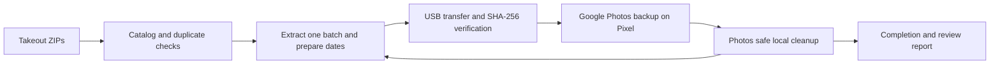

# PixelVault

Move a large Google Photos Takeout library through an original Pixel in small,
resumable batches. The phone performs the cloud backup using Google Photos;
the PC handles extraction, dates, transfer verification and progress.

**Early release · Windows only · English Google Photos UI · original 2016 Pixel**

Built from a real multi-day transfer on a 32 GB Pixel XL. The automation has
been exercised on that device; other Photos versions and the smaller Pixel
have not received an end-to-end hardware test.

## Why an original Pixel?

Google documents unlimited Original-quality photo and video backups from the
[first-generation Pixel](https://support.google.com/pixelphone/answer/6220791?co=GENIE.Platform%3DAndroid&hl=en).
Confirm that your phone actually displays the unlimited-backup benefit before
running. This project does not grant that benefit or reclaim quota charged
for earlier uploads from other devices. Google controls service availability.

## How it works



- Keeps the source ZIPs untouched; extracts only the current batch.
- Detects exact duplicates using CRC/size candidates followed by SHA-256.
- Adds missing dates from unambiguous Takeout JSON without re-encoding media.
- Verifies every active phone copy before asking Android to index it.
- Pauses Photos when the battery temperature reaches the configured limit.
- Restores screen settings and prevents Windows idle sleep during a run.
- Resumes from SQLite and a journal after interruptions.
- Recovers selected ADB connection errors and known Photos hangs with bounded retries.

Cleanup uses Google's [Free up space on this device](https://support.google.com/photos/answer/6128843?hl=en).
The uploader never directly deletes phone media or cloud photos. This Photos
feature can also remove **other backed-up local media on the device**, so use
a dedicated backup phone. Files Photos retains are recorded for review; they
are not counted as completed. Recent backed-up media can legitimately remain
on the phone, according to Google's documentation.

## Requirements

- Windows 10/11 and Python 3.11 or newer (`py --version`). No Python packages required.
- [Android Platform Tools](https://developer.android.com/tools/releases/platform-tools), with `adb` on PATH.
- [ExifTool](https://exiftool.org/), with `exiftool` on PATH, or configured executable paths.
- Original Pixel (`sailfish`) or Pixel XL (`marlin`), USB debugging authorized.
- Wi-Fi; Photos signed into the configured account; **Original** quality and backup enabled.
- Enough PC storage for the archives and one extracted batch; at least 5 GB free on the phone.

No root access, API key, Google password or unofficial Photos API is needed.

## Quick start

Clone this repository and open PowerShell in its directory:

```powershell
Copy-Item config.example.json config.json
adb devices -l
```

Edit `config.json`: set the exact Google account, authorized serial and ZIP
paths. Executable paths and relative archive paths are resolved relative to
the config file. The example values are placeholders and will be rejected.

On the Pixel:

1. Enable USB debugging and authorize your PC. Unlock the phone manually.
2. Confirm the unlimited-backup message and **Original** backup quality.
3. Disable Battery Saver; use reliable Wi-Fi and keep the phone dry and ventilated.
4. Before running, create the configured Pictures folder on the phone and
   copy one test photo into it using the phone's Files app or Windows File
   Explorer. Enable **Collections → On this device → PixelTakeout → Backup**,
   and check that the test photo backs up. An empty folder may not appear.
5. Do not interact with Photos while the uploader controls it.

First prepare a small run:

```powershell
py pixel_uploader.py --catalog-only
py pixel_uploader.py --max-batches 1
```

Folder backup must already be enabled: a global completion message alone
does not prove folder backup. Do not start a large run until the test
batch has appeared in the cloud and its backup details are correct.

Then resume the full run:

```powershell
py pixel_uploader.py
```

Monitor `.pixel-uploader/status.txt`, `status.json` and `run.log`. To stop from
another PowerShell window, run:

```powershell
.\stop.ps1
```

Wait until the uploader exits before unplugging. Start the same command to
resume. A new run clears the stop marker. Keep the config file and archives
unchanged during a session: identity/order/size/timestamps are bound to the
saved state. Use a separate checkout for a different account, device or library.

## Configuration

Defaults are 200 files / 500 MB per batch. For a stable, well-cooled phone,
400 files / 1 GB reduces transfer and cleanup overhead. The 5 GB reserve is
always enforced. Oversized individual videos run alone if they fit.

The battery-sensor thresholds default to 41 C before starting a new batch,
43 C to pause an upload, and 40 C to resume. These are conservative project
choices, not manufacturer-certified limits. Do not cool with ice/water.

The screen remains on and dim, including during cooling; portrait rotation
is fixed during the run. Settings are restored on normal exit. A hard crash
can leave these settings changed and require manual restoration.

## Optional PIN storage

Manual unlocking is the default. If necessary, opt into locally encrypted PIN
storage with `py phone_credentials.py`. Input is hidden and requires confirmation.
Windows DPAPI protects the file for the current Windows user and the helper
binds it to the configured device serial. Processes running as that Windows
user may decrypt it; encryption is not protection against a compromised account.
No PIN is included in the ADB command line or application log.

Stop the uploader before changing the phone PIN. Remove the stored copy with
`py phone_credentials.py --forget`. This does not change the phone's PIN.

## Limits and review items

Completion means the app reported backup complete and its native safe-cleanup
operation removed the local copy. It is **not an independent cloud hash audit**.
There is no guarantee that every Photos UI release has compatible selectors.
Unexpected account/quality, ambiguous UI, retained files and unsupported media
are handled conservatively.

At completion, inspect `.pixel-uploader/files-to-review.json`. Reasons include
missing/ambiguous dates, metadata errors, images below Photos' size minimum,
unsupported media or retained local copies. Review items are not retried
automatically. Albums, comments and cloud-only properties are not recreated.
Existing embedded dates are preserved and can be wrong or ignored by Photos.
Editing working-copy metadata can affect Google's duplicate matching; inspect
your pilot rather than assuming reuploads will merge with existing cloud items.

ZIPs, filenames, account details, local logs, phone snapshots, catalog records
and encrypted credentials must stay private. The supplied `.gitignore` excludes
the standard config and state directory. Keep custom config files outside the
repository, and do not attach personal logs to issues without reviewing them.

## Development

```powershell
py -m unittest discover -s tests -v
```

Offline tests cover failure boundaries, copy verification, safe cleanup,
recovery limits and completion checks. GitHub Actions is configured for Windows
on Python 3.11, 3.12 and 3.13. These tests do not replace a physical-phone pilot.
See [CONTRIBUTING.md](CONTRIBUTING.md) for changes and [SECURITY.md](SECURITY.md)
for private reporting. Licensed under MIT.
